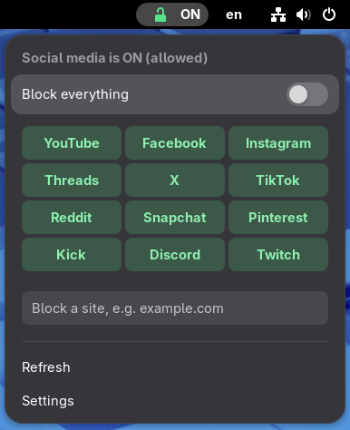
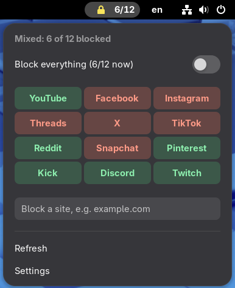
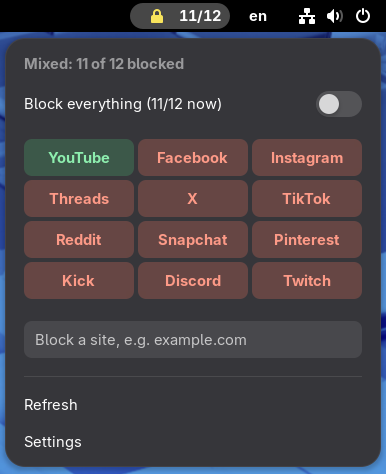
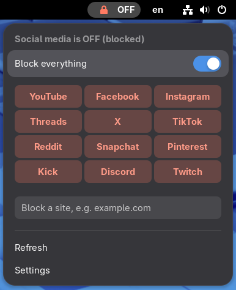

[](https://capsule-render.vercel.app)

[](https://git.io/typing-svg)

[](https://www.gnu.org/software/bash/) [](https://www.gnome.org/) [](https://quickshell.outfoxxed.me/) [](LICENSE)

---

## 📖 About

**social-switch-widget** puts a one-tap control in front of [`social-switch`](core/social-switch) — a small, careful Bash tool that blocks social media system-wide through `/etc/hosts`. Every platform is simply **blocked** or **allowed**; tap a tile, it flips.

**GNOME is the primary edition**: a top-bar extension for GNOME Shell 45–50 (Fedora, Ubuntu, Debian, Arch …). An Omarchy 4 widget shares the same command-line tool.

<table>
<tr>
<td align="center"><br><sub><b>All allowed</b></sub></td>
<td align="center"><br><sub><b>Mixed — 6 of 12 blocked</b></sub></td>
<td align="center"><br><sub><b>Mixed — 11 of 12 blocked</b></sub></td>
<td align="center"><br><sub><b>All blocked</b></sub></td>
</tr>
</table>

The repository holds three things designed to live on one machine without stepping on each other:

| Piece | What it is | Where |
|---|---|---|
| **GNOME extension** | Top-bar lock icon, master switch, tile grid, custom-site entry, optional DNS-filter switch | [`gnome/`](gnome) |
| **`social-switch`** | CLI that blocks/unblocks 12 platforms (and any site you name) in `/etc/hosts` | [`core/`](core) |
| **`cloudflare-switch`** | CLI that turns a Cloudflare DNS filter (family / malware / standard) on or off | [`core/`](core) |

Plus an [Omarchy 4 widget](omarchy-quatto) for the same CLI. The two CLIs work on **any Linux**; the desktop front ends are thin — they read `social-switch status --json` and run `pkexec social-switch …`, with no blocking logic of their own.

---

## 🚀 Quick start

```bash
git clone https://github.com/diea-abdeltwab/social-switch-widget.git
cd social-switch-widget
./install.sh          # detects GNOME / Omarchy / plain Linux, installs everything
```

Then **log out and back in once** (Wayland), and enable *Social Switch* in the Extensions app.

`install.sh` installs the CLIs and polkit policies, installs the extension, removes **older copies of the scripts that would hide the new ones** (a stray `~/.local/bin/social-switch` or `/usr/local/sbin/social-switch` — `sudo` looks in `sbin` first), and re-applies your saved blocks so nothing you had blocked is lost. It does not create backup files.

```bash
./cleanup.sh          # removes leftovers of earlier installs (asks first; --yes to skip the question)
./uninstall.sh        # removes everything (unblocks and turns the DNS filter off first)
```

---

## 🧭 Editions

| You use | Go to | What you get |
|---|---|---|
| **GNOME** — primary | [`gnome/`](gnome) | Top-bar extension (GNOME Shell 45–50) |
| **Anything else / servers / tiling WMs** | [`core/`](core) | The CLIs alone — they need nothing but Bash |
| **Omarchy 4 "Quattro"** | [`omarchy-quatto/`](omarchy-quatto) | Quickshell bar widget with popup |

Pick one explicitly with `./install.sh --edition gnome|omarchy|core`.

---

## 🤝 How the three tools stay out of each other's way

| Concern | `social-switch` | `cloudflare-switch` | Widget / extension |
|---|---|---|---|
| **Touches** | `/etc/hosts` (managed block only) | DNS settings of NetworkManager / systemd-resolved / `resolv.conf` | nothing — only runs the CLI |
| **Never touches** | DNS servers | `/etc/hosts` | `/etc` |
| **Persists** | `/etc/social-switch/` | `/etc/cloudflare-switch/`, `/var/lib/cloudflare-switch/` | GSettings (position, label, DNS row) |
| **Lock** | `/run/social-switch.lock` | `/run/cloudflare-switch.lock` | one action at a time (`busy` guard) |
| **Undo** | `social-switch on` | `cloudflare-switch off` | uninstall unblocks first |

Things worth knowing:

- **Opposite habits.** `social-switch on` means *social media is ON (allowed)*; `cloudflare-switch on` means *the filter is ON (active)*. Both print their meaning; the UI uses the social-switch vocabulary (ON = allowed, OFF = blocked).
- **`0.0.0.0` can come from either layer.** Cloudflare Family DNS also answers `0.0.0.0` for some domains. `social-switch doctor` tells hosts-file blocking apart from resolver-level filtering instead of blaming `/etc/hosts`.
- **One copy of each script.** All front ends install from [`core/`](core). The installer refuses to silently downgrade a newer script and removes stale copies that would shadow the real one.
- **Older state is migrated, never dropped.** Platforms that earlier builds had (Messenger, Tumblr) keep working as custom sites, so an upgrade can't quietly unblock them.

---

## 🗂️ Project Structure

```
social-switch-widget/
├── install.sh / uninstall.sh / cleanup.sh   # one-command install, removal, leftovers cleanup
├── core/                               # the shared, desktop-independent part
│   ├── social-switch                    # hosts-file blocker (v2.2)
│   ├── cloudflare-switch                # DNS filter switch (v2.0, multi-backend)
│   ├── polkit/                          # one polkit action per tool
│   ├── install-core.sh / uninstall-core.sh
│   ├── tests/                           # offline test suites (no root needed)
│   └── README.md
├── gnome/                              # GNOME Shell 45–50 extension (primary edition)
│   ├── social-switch@diea-abdeltwab.github.io/
│   ├── screenshots/
│   ├── install.sh / uninstall.sh
│   ├── tests/
│   └── README.md
├── omarchy-quatto/                     # Omarchy 4 Quickshell widget
│   ├── plugin/                          # manifest.json, Widget.qml, Panel.qml
│   ├── screenshots/
│   ├── install.sh / uninstall.sh
│   └── README.md
├── LICENSE
└── README.md
```

---

## 🧪 Tests

The logic that matters is tested without root and without touching your real system:

```bash
# the two CLIs (run as a normal user - the test hook is deliberately ignored for root)
bash core/tests/test_social_switch.sh        # 26 checks
bash core/tests/test_cloudflare_switch.sh    # 28 checks, uses fake nmcli/systemctl/resolvectl

# the GNOME extension's logic
node --test gnome/tests/socialLogic.test.mjs   # 12 checks, incl. real CLI output
```

The GNOME UI and the Quickshell QML need a real session to run, so they are covered by syntax checks and manual testing rather than automated tests.

---

## 🧭 Roadmap

- [x] DNS-filter switch inside the GNOME popup (opt-in in Preferences)
- [ ] Choose the DNS preset (family / malware / standard) from the popup
- [ ] Optional per-platform schedule (e.g. auto-block during work hours)
- [ ] Config-driven platform list instead of editing the script
- [ ] A KDE Plasma / waybar front end

---

## 🤝 Contributing

Issues and PRs are welcome — especially reports from distributions and GNOME versions this hasn't been tried on yet.

---

## 📜 License

Released under the [MIT License](LICENSE).

---

### 👤 Author

**Diea Abdeltwab** — Data Engineer · Software Engineer

[](https://www.linkedin.com/in/diea-abdeltwab/) [](https://github.com/diea-abdeltwab) [](mailto:dieaabdeltwab2024@gmail.com)

[](https://capsule-render.vercel.app)
