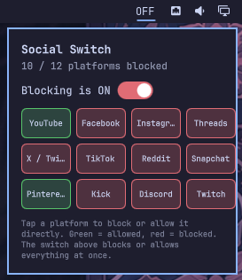

[](https://capsule-render.vercel.app)

[](https://git.io/typing-svg)

<p align="center">
  <a href="https://www.gnu.org/software/bash/"></a>
  <a href="https://quickshell.outfoxxed.me/"></a>
  <a href="https://omarchy.org/"></a>
  <a href="https://github.com/diea-abdeltwab/social-switch-widget/blob/main/LICENSE"></a>
</p>

---

## 📖 About

This is the **Omarchy 4 edition** of [social-switch-widget](../README.md) (the primary edition is [GNOME](../gnome)). It wraps [`social-switch`](../core/social-switch) — the `/etc/hosts`-based social media blocker shared by every front end in this repo — in an Omarchy 4 ("Quattro") bar widget. A small `ON`/`OFF` icon opens a popup with a global switch and a tap-to-block grid, one tile per platform. No terminal, no remembering flags.

Every platform is simply **blocked** or **allowed** — there's no separate "exclude" concept layered on top of a global mode. Tap a tile, it flips, full stop.

---

## 🖼️ Preview

<table>
<tr>
<td align="center"><br><sub><b>All allowed</b></sub></td>
<td align="center"><br><sub><b>All blocked</b></sub></td>
<td align="center"><br><sub><b>Mixed — 10/12</b></sub></td>
<td align="center"><br><sub><b>Mixed — 4/12</b></sub></td>
</tr>
</table>

The bar icon reads `ON` when nothing's blocked and `OFF` when anything is — same word, same meaning, in both the icon and the popup, on purpose.

---

## ✨ Features

- 🟢🔴 **Tap-to-toggle grid** — every platform is independently blocked (red) or allowed (green); tapping a tile flips just that one
- 🎚️ **Bulk global switch** — `ON` sets every platform to allowed, `OFF` sets every platform to blocked, regardless of individual state a second ago
- 🌗 **Genuine mixed-state indicator** — block one platform out of twelve and the switch shows a real partial position (orange, thumb centered) instead of snapping to a misleading full ON/OFF
- 🔐 **Polkit, scoped** — every toggle asks for your password via a dedicated `pkexec` action bound to this one script, not a blanket sudoers rule
- 💾 **Single source of truth** — `/etc/social-switch/blocked` is authoritative; `/etc/hosts` is a reflection of it, so nothing can drift out of sync
- ⚡ **No redundant polling** — status is fetched once by the bar icon and pushed into the popup; the popup never runs its own second poll
- 🩹 **Self-healing hint** *(1.1)* — if another tool wipes the blocks from `/etc/hosts`, the icon reads `OFF!`, the affected tiles turn amber and the popup offers a one-tap re-apply (`social-switch sync`)
- 🧩 **One shared CLI** *(1.1)* — installs from [`../core`](../core) together with `cloudflare-switch`; no private copy of the script to drift out of date

---

## 📦 Requirements

- Omarchy **4.x ("Quattro")** — provides the Quickshell bar this widget loads into
- `polkit` (`pkexec`) — for privileged block/unblock/on/off actions
- `bash` ≥ 4.4, `awk`, `flock` — the CLI itself

```bash
# Arch / Omarchy
sudo pacman -S polkit
```

> **Not on Omarchy?** The same CLI has a GNOME edition → [`../gnome`](../gnome).

---

## 🚀 Installation

```bash
# 1. Clone the repo
git clone https://github.com/diea-abdeltwab/social-switch-widget.git
cd social-switch-widget/omarchy-quatto

# 2. Run the installer
./install.sh
```

The installer checks dependencies, backs up your Quickshell config (`shell.json`) before editing it, lets you pick a bar section (left/center/right), installs the shared CLI tools + polkit policy (from `../core`; it never silently downgrades what's already there) and the plugin, validates the plugin (`omarchy plugin validate`, `qmllint`) before enabling it, and reloads the shell live — no restart needed.

```bash
# Uninstall
./uninstall.sh
```
Removes the plugin; asks separately whether to remove the CLI tools and polkit policy, unblocking everything and turning the DNS filter off first.

---

## 🎬 Usage

**From the bar:** click the icon to open the popup, click the switch to block/allow everything, tap any tile to flip just that platform.

**From the terminal**, the underlying CLI works exactly the same way:

```bash
social-switch status                 # per-platform table, no root needed
social-switch status --json          # same, machine-readable
social-switch list                   # every platform key

sudo social-switch on                # allow everything
sudo social-switch off               # block everything
sudo social-switch off --except discord,twitch   # block everything except a couple
sudo social-switch off example.com   # any other site (not shown in the popup; the popup lists a count)
sudo social-switch sync              # re-write saved blocks into /etc/hosts

sudo social-switch block reddit      # block just Reddit
sudo social-switch unblock reddit    # allow it again

social-switch doctor                 # duplicate /etc/hosts entries, DNS-over-HTTPS bypass check
```

**Platforms tracked:** YouTube, Facebook, Instagram, Threads, X/Twitter, TikTok, Reddit, Snapchat, Pinterest, Kick, Discord, Twitch. Edit `PLATFORM_DOMAINS` near the top of `core/social-switch` to add, remove, or re-scope any of them. Messenger and Tumblr, which older builds tracked, are kept blocked as custom sites if you had them blocked.

---

## 🏗️ Architecture

```
                 ┌────────────────────────────┐
   bar icon ──▶  │  plugin/Widget.qml         │  polls status every 20s
                 │  - owns the status Process │  via `social-switch status --json`
                 │  - Loader → Panel.qml      │
                 └───────────────┬────────────┘
                                 │ injects bar / anchorItem / hostWidget
                                 ▼
                 ┌────────────────────────────┐
                 │  plugin/Panel.qml          │  popup: switch + platform grid;
                 │  - KeyboardPanel/          │  asks hostWidget.refresh() after
                 │    PanelKeyCatcher         │  any pkexec action
                 └───────────────┬────────────┘
                                 │ pkexec (per privileged action)
                                 ▼
                 ┌────────────────────────────┐
                 │  /usr/local/bin/           │  root, via pkexec —
                 │  social-switch  (../core)  │
                 │  (bash)                    │  BLOCKED_FILE is the
                 └───────────────┬────────────┘  single source of truth
                                 ▼
                          /etc/hosts (managed block)
                        /etc/social-switch/blocked
```

**File naming note:** the plugin entry point is `Widget.qml`, not `BarWidget.qml` as the official Omarchy plugin guide names it — naming it identically to the `BarWidget` type it instantiates caused a "File name case mismatch" load failure on this system. Same root element, different filename.

---

## 🔐 Privilege model

Every toggle prompts for your password via `pkexec`, scoped to `/usr/local/bin/social-switch` specifically through a dedicated polkit action — not a sudoers `NOPASSWD` rule, which would mean *no* authentication ever, from any process able to invoke sudo as you, for as long as the rule exists.

The polkit action grants "run this exact binary as root with any arguments," not "run only valid subcommands with valid platform names" — that argument-level enforcement lives inside the script itself (`require_root`, `is_valid_platform`), since polkit action definitions can't express it directly.

---

## 🩺 Troubleshooting

<details>
<summary><strong>Icon doesn't appear on the bar</strong></summary>
<br>

Check `omarchy plugin list` shows `diea.social-switch` as enabled, and that it appears somewhere under `bar.layout` in `~/.config/omarchy/shell.json`. If it's there but nothing renders, force a full restart (`omarchy-restart-shell`), then check `qs log -p "$OMARCHY_PATH/shell" --tail 100` for anything mentioning `social-switch`, `Widget.qml`, or `Panel.qml`.
</details>

<details>
<summary><strong>Log shows "File name case mismatch"</strong></summary>
<br>

`install.sh` wipes the plugin directory before copying fresh files in, specifically to prevent a stale file from an earlier version tripping this. If it still happens:
```bash
rm -rf ~/.config/omarchy/plugins/diea.social-switch ~/.cache/quickshell ~/.cache/qmlcache
./install.sh
```
</details>

<details>
<summary><strong>Toggle does nothing / no polkit prompt appears</strong></summary>
<br>

Test the privileged path directly, outside the widget:
```bash
pkexec /usr/local/bin/social-switch off --except discord
```
If that works but the bar doesn't, check `qs log` for errors from the `privProc` Process in `Panel.qml`.
</details>

<details>
<summary><strong>Sites still load even though the widget shows "blocked"</strong></summary>
<br>

Browsers with Secure DNS / DNS-over-HTTPS bypass `/etc/hosts` entirely. Run `social-switch doctor` for a full diagnosis, or disable Secure DNS in the browser.
</details>

---

## 🗂️ Project Structure

```
omarchy-quatto/
├── plugin/
│   ├── manifest.json                   # entryPoints.barWidget → Widget.qml (v1.1.0)
│   ├── Widget.qml                       # bar icon; owns the status Process; loads Panel.qml
│   └── Panel.qml                         # popup content (switch + platform grid)
├── screenshots/
├── install.sh                          # installer (validates before enabling)
├── uninstall.sh                        # clean removal
└── README.md

../core/                                # shared: social-switch, cloudflare-switch, polkit policy, installers
```

---

## 🆕 What changed in 1.1

This release fixes the ways the widget and the command-line tools could get in each other's way:

| Problem | Fix |
|---|---|
| The installer shipped its **own older copy** of `social-switch` and overwrote a newer one installed by hand (losing URL blocking, IPv6, locking) | One script, in `../core`; installer refuses silent downgrades and warns about stale copies |
| A newer CLI reports a **`mixed`** mode and `broken` / `external` statuses; the widget only understood `on`/`off` and `blocked`/`allowed` — so tiles of a *broken* block showed green and the icon could disagree with `social-switch status` | Widget and popup now count what you **asked** for (`wanted_count`) like the CLI, show amber tiles + `OFF!` when `/etc/hosts` lost a block, and offer **re-apply** |
| Tapping a tile whose block had been lost sent the wrong command | Direction now follows the saved intent (`wanted`), not the on-disk state |
| Messenger / Tumblr from older builds silently dropped from the state file (= unblocked on the next change) | Migrated to custom sites on first run |
| Custom sites were invisible in the popup | Popup shows a "+ N custom site(s)" line |

> The QML changes were checked with `qmllint` (syntax) and against the real `status --json` output of the CLI, but not on a live Quickshell session — if you hit a rendering problem, `qs log -p "$OMARCHY_PATH/shell" --tail 100` is the first place to look.

---

## 🧭 Roadmap

- [ ] Optional per-platform schedule (e.g. auto-block during work hours)
- [ ] Config-driven platform list instead of editing the script directly
- [ ] A settings row in the popup for quick section/position changes

---

## 🤝 Contributing

Issues and PRs welcome — especially reports of Quickshell/QML behavior on Omarchy versions or configs this hasn't been tested against yet.

---

## 📜 License

Released under the [MIT License](../LICENSE).

---

### 👤 Author

**Diea Abdeltwab** — Data Engineer · Software Engineer

<p align="center">
  <a href="https://www.linkedin.com/in/diea-abdeltwab/"></a>
  <a href="https://github.com/diea-abdeltwab"></a>
  <a href="mailto:diea.abdeltwab@gmail.com"></a>
</p>

[](https://capsule-render.vercel.app)
